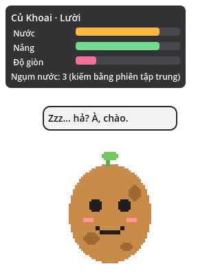
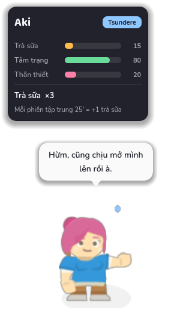
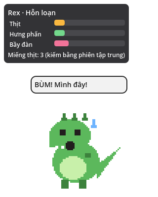
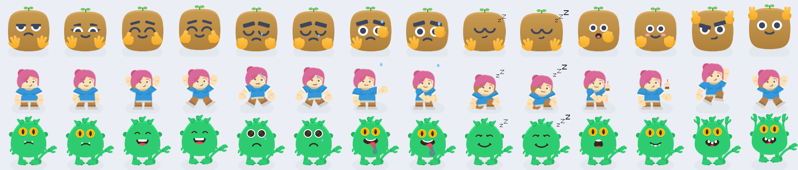

# DeskBuddy

Bất cứ thứ gì cũng có thể là bạn đồng hành trên màn hình: củ khoai, cô gái anime,
khủng long, siêu nhân, cục gì đó. Nhân vật ngồi ở góc màn hình, phản ứng khi bạn
làm việc, và được "cho ăn" bằng chính thời gian tập trung của bạn.

Đây là MVP viết bằng **Godot 4.3**, chạy trên Windows, macOS và Linux.

| Củ Khoai (lười) | Aki (tsundere, đang đói) | Rex (hỗn loạn, đang buồn) |
|---|---|---|
|  |  |  |

## Chạy thử

1. Cài [Godot 4.3](https://godotengine.org/download) (bản thường, không cần .NET).
2. Mở Godot → Import → chọn `deskbuddy/project.godot`.
3. Nhấn F5. Nhân vật xuất hiện ở góc phải dưới màn hình.

Chạy test headless (không cần mở editor):

```bash
cd deskbuddy
godot --headless --path . -s tests/run_tests.gd
```

Chụp màn hình tự động để kiểm tra hiển thị (cần màn hình hoặc Xvfb):

```bash
godot --path . -s tools/screenshot.gd -- out.png 120 potato hud hungry
# trên máy không có màn hình:
xvfb-run -a godot --path . --rendering-driver opengl3 --audio-driver Dummy \
  -s tools/screenshot.gd -- out.png 120 rex hud sad
```

Cả hai đã được chạy với Godot 4.3 trên Linux: 56 test qua, ba pack dựng
hình đúng.

## Điều khiển

| Thao tác | Kết quả |
|---|---|
| Click trái vào nhân vật | Vuốt ve (+tâm trạng, +gắn kết, có cooldown) |
| Kéo nhân vật | Di chuyển cửa sổ, vị trí được lưu |
| Rê chuột lên nhân vật | Hiện 3 thanh nhu cầu |
| Click phải | Menu: cho ăn, vuốt ve, phiên tập trung, đổi nhân vật, mở thư mục packs, thoát |

Phần trong suốt của cửa sổ cho click xuyên xuống desktop, chỉ vùng nhân vật
nhận chuột.

## Cách nó hoạt động

- **Ba thanh nhu cầu chung** (`scripts/buddy_needs.gd`): energy, mood, bond.
  Pack chỉ đổi tên hiển thị. Không bao giờ chết, chỉ xuống sàn 10 và buồn.
  Mở app lại sau nhiều ngày chỉ bị trừ tối đa 12 giờ decay.
- **Tính cách tách khỏi hình hài** (`scripts/personality.gd`): 6 archetype
  (bám người, lười, tsundere, hỗ trợ, hỗn loạn, nghiêm khắc). Mỗi archetype có
  hệ số decay, nhịp bắt chuyện và câu nói cho 12 sự kiện. Pack chọn một và có
  thể override từng nhóm câu.
- **Đồ ăn chỉ kiếm bằng phiên tập trung** (`scripts/focus_session.gd`): 25 phút
  = 1 phần ăn. Không có đường mua bằng tiền.
- **Theo dõi hoạt động** (`scripts/activity_monitor.gd`): idle sau 5 phút chuột
  không động → nhân vật ngủ; gõ phím dồn dập → nhân vật hưng phấn. Mọi dữ liệu
  chỉ ở RAM, không ghi, không gửi.
- **Pack** (`docs/PACK_FORMAT.md`): một thư mục có `pack.json` + sprite sheet.
  Pack đi kèm ở `packs/`, pack người dùng ở thư mục `user://packs` (menu
  "Mở thư mục packs" dẫn tới đó). Pack lỗi vẫn hiện trong menu kèm lý do.
- **Lưu trữ**: `user://save.json`, toàn bộ local.

Năm pack mẫu: **Củ Khoai** (lười), **Aki** (tsundere), **Rex** (hỗn loạn),
**Kẹo** (bám người, kind `shape`) và **Zom** (hỗ trợ, kind `image`).
Sprite được ghép từ bộ phận của Kenney (CC0) bằng `tools/compose_packs.py`;
các bộ phận đã dùng nằm trong `art_src/kenney/`. Thay art riêng chỉ cần đè
file `sprites.png` của pack.



```bash
# Dựng lại 3 sheet (chỉ cần Python 3, không cần thư viện ngoài)
python3 tools/compose_packs.py --preview /tmp/preview.png
```

## Workshop: người chơi tự tạo nhân vật

Menu chuột phải → **Workshop**:

| Mục | Làm gì |
|---|---|
| Tạo từ ảnh bất kỳ… | Chọn PNG/JPG (meme, ảnh thú cưng, củ khoai thật). Tuỳ chọn xoá nền đơn sắc lấy từ 4 góc ảnh. Đặt tên, tính cách, tên món ăn và nhãn 3 thanh. Engine tự tạo chuyển động và cảm xúc |
| Ghép nhân vật từ bộ phận… | Chọn thân, màu, mặt, tay từ bộ Kenney, xem trước ngay. Không cần vẽ gì |
| Nhập pack (.zip)… | Nhận pack bạn bè gửi |
| Xuất nhân vật hiện tại (.zip)… | Đóng gói để chia sẻ |

Pack tạo ra nằm ở `user://packs/<id>/`, cùng định dạng mở trong
`docs/PACK_FORMAT.md`, nên họa sĩ có thể mở ra sửa tay.

Steam Workshop sau này chỉ là lớp vận chuyển cho đúng những thư mục này
(upload zip lên, tải về giải nén vào `user://packs`).

### Vì sao chưa có model 3D

Hỗ trợ VRM/glTF là việc đáng làm nhưng là một pha riêng: cần addon VRM cho
Godot, cửa sổ 3D trong suốt, retarget animation cho từng model và máy yếu sẽ
tốn pin hơn nhiều. Định dạng pack đã chừa sẵn: `kind: "vrm"` sẽ là loại thứ
tư, mọi thứ khác (nhu cầu, tính cách, câu nói, Workshop, zip) dùng lại nguyên.

## Giới hạn đã biết của MVP

- Godot chỉ nhận bàn phím khi cửa sổ có focus, nên "gõ dồn dập" mới chỉ bắt
  được khi app đang focus. Chuột thì bắt toàn hệ thống. Để bắt bàn phím toàn hệ
  thống cần một GDExtension nhỏ (Windows `GetLastInputInfo`, macOS `CGEventTap`
  với quyền Accessibility). Signal của `ActivityMonitor` giữ nguyên khi thay.
- Chưa đọc tên app đang mở (cần cho tính năng "nhìn chằm chằm khi mở YouTube").
- Chưa có khay hệ thống, chưa tự chạy khi đăng nhập.
- Chưa có 3D (VRM). Xem mục Workshop ở trên.
- Font Nunito và Baloo 2 không có emoji, nên icon trong pack để trống.

## Ghi công

- Art nhân vật: [Kenney](https://www.kenney.nl) · Shape Characters,
  Platformer Characters, Monster Builder Pack · CC0 1.0
  (`art_src/kenney/LICENSE-Kenney-CC0.txt`).
- Font: Nunito (Vernon Adams và cộng sự) và Baloo 2 (Ek Type) · SIL Open
  Font License 1.1 (`assets/fonts/OFL-*.txt`).

## Khi export

Thêm `*.json` vào Export → Resources → "Filters to export non-resource files"
để `pack.json` của các pack đi kèm được đóng vào PCK.

## Hướng tiếp theo

1. Khay hệ thống + tự khởi động.
2. GDExtension bắt bàn phím và app đang focus.
3. Steam Workshop: upload/download zip pack về `user://packs`.
4. Hai nhân vật cùng lúc và tương tác theo archetype.
5. Phiếu báo cáo cuối tuần.
6. `kind: "vrm"`: model 3D.
